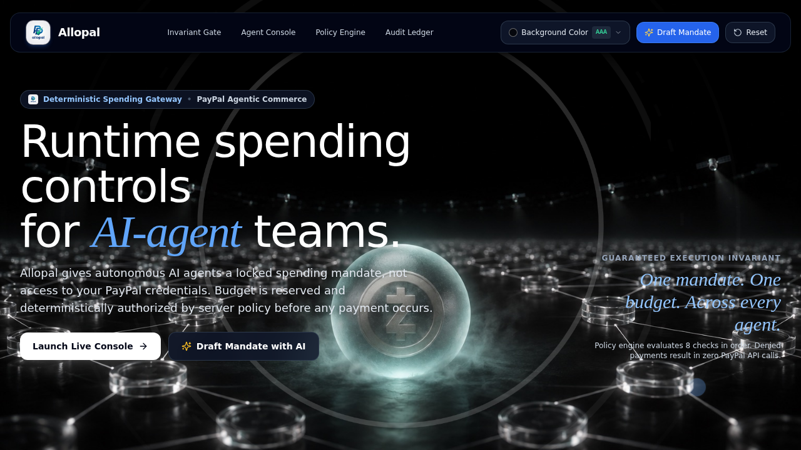

# Allopal

<p align="center">
  
</p>

<p align="center">
  
</p>

> **Deterministic Spending Authorization Layer for PayPal Agentic Commerce**

[](https://www.typescriptlang.org/)
[](https://nextjs.org/)
[](https://www.prisma.io/)
[](https://developer.paypal.com/)
[](https://vitest.dev/)

---

##  Overview

**Allopal** is a security-first authorization gateway designed for autonomous AI agents participating in commerce.

When autonomous agents are empowered to shop or pay for goods on behalf of humans, granting them direct access to financial credentials presents an unacceptable risk. Allopal solves this by decoupling **intent** from **authorization** and **execution**:

1. **Human Intent & Mandate Locking**: A human creates and explicitly locks a spending mandate with strict boundaries (spending limits, allowed merchants, permitted categories, expiration windows).
2. **Deterministic Authorization**: The payment request is strictly evaluated by an authoritative, deterministic policy engine on the server. AI models are **never** permitted to independently authorize money movement.
3. **PayPal Execution**: PayPal order creation and capture are only invoked if and only if the locked mandate's policy checks evaluate to `ALLOWED`.

---

##  Core Invariant

```
MANDATE PASSES (ALLOWED)  ──▶  CREATE PAYPAL ORDER  ──▶  CAPTURE PAYPAL ORDER
MANDATE FAILS  (DENIED)   ──▶  NO PAYPAL CALL       ──▶  ZERO MONEY MOVEMENT
```

* **Zero-Bypass Policy**: Under no circumstances can client code or AI prompts trigger a PayPal transaction without satisfying an active, non-revoked mandate with sufficient remaining budget.
* **Denial Audit Record**: Every denial persists a structured `Decision` audit log detailing the exact check failed, with `paypalOrderId = null`.

---

##  Architecture

```
                  ┌──────────────────────────────────────────────┐
                  │            Client / AI Agent                 │
                  └──────────────────────┬───────────────────────┘
                                         │ POST /api/payments/pay
                                         │ { mandateId, cartId }
                                         ▼
                  ┌──────────────────────────────────────────────┐
                  │       Authoritative Payment Gateway          │
                  │        (Next.js Route Handler)               │
                  └──────────────────────┬───────────────────────┘
                                         │
                   Fetch authoritative   │ Server-side database lookup
                   Mandate, Cart & Items │ (Client prices/categories ignored)
                                         ▼
                  ┌──────────────────────────────────────────────┐
                  │          Deterministic Policy Engine         │
                  │           (lib/policy/engine.ts)             │
                  └──────────────┬───────────────────────────────┘
                                 │
                 ┌───────────────┴───────────────┐
                 │                               │
        [Policy Check FAILS]            [Policy Check PASSES]
                 │                               │
                 ▼                               ▼
       ┌───────────────────┐           ┌───────────────────┐
       │ Persist Decision  │           │   PayPal Client   │
       │ (DENIED audit log)│           │ (lib/paypal/client│
       └─────────┬─────────┘           └─────────┬─────────┘
                 │                               │ 1. Create Order
                 ▼                               ▼ 2. Capture Order
          Return 403 /                   ┌───────────────────┐
          Policy Denied                  │ Persist Decision  │
          (No PayPal call)               │ (COMPLETED + IDs) │
                                         │ Update Mandate    │
                                         │ Remaining Budget  │
                                         └─────────┬─────────┘
                                                   │
                                                   ▼
                                           Return 200 OK
```

### Key Architectural Boundaries

* **Untrusted Client Inputs**: The client supplies only `mandateId` and `cartId`. The server reloads authoritative prices, categories, and merchant metadata from the database to defeat client-side tampering.
* **Exact Integer Cents**: Monetary values are stored and calculated as integers in cents (e.g., `$18.00 = 1800 cents`) to prevent floating-point rounding errors.
* **Server-Side Secret Isolation**: PayPal Client ID, Secret, and AI keys are strictly kept server-side and never exposed to client bundles.

---

##  Deterministic Policy Engine

The policy engine (`lib/policy/engine.ts`) runs an ordered sequence of deterministic checks:

| Step | Check Name | Description | Failure Reason |
|:---:|:---|:---|:---|
| **1** | **Mandate Exists** | Verifies the referenced mandate exists in database | `Mandate not found` |
| **2** | **Mandate Active** | Ensures mandate status is `ACTIVE` (not `PENDING` or `EXPIRED`) | `Mandate is not active` |
| **3** | **Not Revoked** | Verifies status is not `REVOKED` | `Mandate has been revoked` |
| **4** | **Time Window** | Checks current timestamp against `validFrom` and `validUntil` | `Mandate has expired or is not yet valid` |
| **5** | **Merchant Allowed** | Verifies cart's merchant is in `allowedMerchants` | `Merchant '{merchant}' is not allowed by this mandate` |
| **6** | **Category Allowed** | Verifies cart item categories are in `allowedCategories` | `Category '{category}' is not allowed by this mandate` |
| **7** | **Amount Valid** | Cart total must be strictly positive (`> 0`) | `Invalid cart amount: must be greater than 0` |
| **8** | **Budget Remaining** | `spentAmount + cartAmount <= totalLimit` | `Insufficient mandate budget: requires ${x}, only ${y} remaining` |

---

##  Primary Demo Scenarios

The test suite and seed data deterministically verify the canonical primary scenarios:

* **Mandate**: `School Shopping`
* **Limit**: `$40.00` (4000 cents)
* **Allowed Category**: `School Supplies`
* **Allowed Merchants**: `Campus Books`, `Paper & Pencil`

### Scenarios Table

| Scenario | Cart Item | Cost | Category | Merchant | Mandate State | Result | PayPal Call |
|:---|:---|:---:|:---:|:---:|:---:|:---:|:---:|
| **Case A** | Notebook Bundle | `$18.00` | School Supplies | Campus Books | Active ($40 remaining) |  **PASS** | **Order Created & Captured** |
| **Case B** | Gaming Headset | `$90.00` | Electronics | Campus Books | Active ($40 remaining) |  **DENIED** | **Zero Calls** |
| **Case C** | Heavy Notebook Bundle | `$25.00` | School Supplies | Campus Books | Active ($22 remaining) |  **DENIED** | **Zero Calls** |
| **Case D** | Supplementary Pens | `$8.00` | School Supplies | Campus Books | **Revoked** |  **DENIED** | **Zero Calls** |
| **Case E** | Natural Language Prompt | - | - | - | Proposed by AI |  **PENDING** | **Requires Explicit Human Lock** |

---

##  API Reference

### 1. `POST /api/authorize`
Dry-run policy evaluation. Verifies if a mandate allows a cart purchase without charging PayPal.

* **Request Body**:
  ```json
  {
    "mandateId": "mandate-school-shopping",
    "cartId": "cart-case-a"
  }
  ```
* **Response (Allowed)**:
  ```json
  {
    "allowed": true,
    "decisionId": "dec-...",
    "status": "APPROVED",
    "amount": 1800,
    "merchant": "Campus Books",
    "category": "School Supplies",
    "remainingBudget": 4000,
    "checks": { ... }
  }
  ```

---

### 2. `POST /api/payments/pay`
Authoritative payment execution route. Evaluates policy, creates PayPal sandbox order, captures funds, increments mandate spent budget, and records complete audit trail.

* **Request Body**:
  ```json
  {
    "mandateId": "mandate-school-shopping",
    "cartId": "cart-case-a"
  }
  ```
* **Response (Completed)**:
  ```json
  {
    "success": true,
    "status": "COMPLETED",
    "decisionId": "dec-...",
    "paypalOrderId": "SANDBOX-ORDER-...",
    "paypalCaptureId": "SANDBOX-CAPTURE-...",
    "amount": 1800,
    "spentAmount": 1800,
    "remainingBudget": 2200,
    "paypalCalled": true
  }
  ```
* **Response (Denied)**:
  ```json
  {
    "error": "Payment authorization denied by mandate policy",
    "reason": "Category 'Electronics' is not allowed by this mandate",
    "status": "DENIED",
    "paypalCalled": false
  }
  ```

---

### 3. `GET /api/health`
Health check and database ping.

* **Response**:
  ```json
  {
    "status": "healthy",
    "timestamp": "2026-10-02T22:20:00.000Z",
    "database": "connected"
  }
  ```

---

##  Database Schema

Managed via Prisma (`prisma/schema.prisma`):

* **`Mandate`**: Human-configured spending rule.
  * Fields: `id`, `name`, `weeklyLimit` (cents), `spentAmount` (cents), `validFrom`, `validUntil`, `status` (`ACTIVE`, `PENDING`, `EXPIRED`, `REVOKED`), `allowedCategories` (JSON string array), `allowedMerchants` (JSON string array).
* **`Product`**: Catalog item with server-authoritative `price` (cents), `category`, and `merchant`.
* **`Cart`** & **`CartItem`**: Authoritative cart contents referenced by `cartId`.
* **`Decision`**: Immutable audit record for every payment evaluation. Stores result (`APPROVED` / `DENIED`), failed reason, policy checks breakdown, and `paypalOrderId`.
* **`PayPalTransaction`**: Detailed ledger of PayPal sandbox responses.

---

##  Getting Started

### Prerequisites

* Node.js 18.x or 20.x
* npm or pnpm

### 1. Installation

```bash
git clone https://github.com/Tajudeeen/allopal.git
cd allopal
npm install
```

### 2. Environment Configuration

Copy the example environment file:

```bash
cp .env.example .env
```

Ensure `.env` contains:
```env
DATABASE_URL="file:./prisma/dev.db"
NODE_ENV="development"
PORT=3000
PAYPAL_CLIENT_ID="mock_client_id"
PAYPAL_CLIENT_SECRET="mock_client_secret"
PAYPAL_API_BASE_URL="https://api-m.sandbox.paypal.com"
```

### 3. Database Migration & Seed

Run migrations and seed the canonical test data:

```bash
npm run prisma:generate
npm run prisma:migrate
npm run prisma:seed
```

### 4. Running the Application

```bash
npm run dev
```

Visit [http://localhost:3000](http://localhost:3000). The frontend layout is modeled after the design language of [usereins.xyz](https://usereins.xyz/), featuring:
* **Adaptive Text Engine (WCAG AAA Relative Luminance)**: Every text element, heading, card, badge, and input dynamically calculates and adapts its foreground contrast against any active background color:
  * **Mathematical Contrast Evaluation (`lib/theme/contrast.ts`)**: Evaluates relative luminance `L = 0.2126 * R + 0.7152 * G + 0.0722 * B` and contrast ratios in real time.
  * **Preset Backgrounds**: Obsidian Void (`#05070d`), Alabaster Daylight (`#f8fafc`), PayPal Midnight (`#00133d`), Cyber Emerald (`#031c16`), Amethyst Deep (`#1a082b`), and Warm Amber (`#fffbeb`).
  * **Interactive Custom Color Picker**: Users can pick any color via the HTML5 spectrum or enter any 6-digit hex code; all typography, glass cards, and badges immediately adapt with guaranteed readability.
  * **Live WCAG Status Indicator**: In-navbar badge showing real-time luminance, contrast ratio (e.g., `15.2:1 AAA`), and active typography tokens (Crisp White `#FFFFFF` vs Deep Slate `#0F172A`).
* **Floating Glass Pill Navigation**: Translucent backdrop-filtered navbar with real-time background color selector, live contrast stats, section anchors, and modal triggers.
* **Editorial Hero & Invariant Banner**: Bold typography, italic serif accents, and high-contrast formula presentation (`MANDATE PASSES → PAYPAL CAPTURE`).
* **Desktop Console Stage**: MacOS-style application container (`allopal-runtime-v1 // paypal-sandbox // policy-gate`) framing the live Mandate and Agent Commerce simulators.
* **Status Pipeline & Specification Cards**: Visual check chips (`ALLOWED`, `DENIED`, `RESERVED`) and gradient-accented security architecture cards.

---

##  Testing & Verification

Allopal maintains a comprehensive automated test suite testing every boundary, policy rule, PayPal integration invariant, concurrency protection, theme contrast engine, and AI flow:

```bash
npm test
```

**Test Suite Health: 13 passed / 65 passed (100% pass rate)**

### Test Coverage Highlights

* `tests/foundation.test.ts`: Environment validation and schema structure.
* `tests/theme/contrast.test.ts`: WCAG relative luminance math, contrast ratios, and adaptive typography token guarantees.
* `tests/database_seed.test.ts`: Exact cents representation, timestamps, and seed data integrity.
* `tests/policy/engine.test.ts`: Comprehensive policy engine tests (12 tests covering invalid merchant, disallowed category, boundary conditions, revoked mandates, zero amount).
* `tests/api/authorize.test.ts`: Server-side authorization endpoint security and client-tamper resistance.

* `tests/payments/paypal.test.ts`: Real PayPal sandbox abstraction, order creation, capture, budget decrementing, and the critical **zero-call failure boundary proof**.
* `tests/payments/security_boundary.test.ts`: Dedicated tests proving 0 PayPal API calls for disallowed categories, over-budget purchases, and revoked mandates.
* `tests/payments/concurrency.test.ts`: Prevents race conditions (e.g. two concurrent $25 purchases against a $40 limit will never charge $50) and handles idempotent request replays.
* `tests/ai/proposal.test.ts`: Verifies natural-language mandate parsing, validation bounds, and strict human approval gating.
* `tests/ai/explainer.test.ts`: Evaluates structured AI decision explanations for allowed and denied payment decisions.
* `tests/e2e/allopal_full_flow.test.ts`: End-to-end specification test executing the canonical primary demo across Cases A, B, C, and D.
* `tests/security/security_audit.test.ts`: Multi-vector security audit testing price tampering, category injection, and credential leak prevention.
* `tests/failures/failure_recovery.test.ts`: Fail-closed rollback invariants guaranteeing reserved budgets release if PayPal or network fails.

---

##  Security Best Practices

1. **Client Price Tampering Defeated**: Prices sent in client payloads are strictly ignored. Product prices are looked up directly from the database using authoritative product IDs.
2. **Revocation Immutability**: Once a mandate status is set to `REVOKED`, no evaluation can pass regardless of limit or remaining balance.
3. **Exact Boundary Compliance**: A mandate with `$22.00` remaining allows an exact `$22.00` purchase and rejects a `$22.01` purchase.
4. **Isolated Credentials**: All PayPal sandbox credentials and AI API keys remain exclusively on the server runtime.

---

##  Updating Documentation

> **Note for Contributors & Agents**:
> Whenever new features, routes, database models, or policy rules are implemented:
> 1. Keep the README up to date immediately.
> 2. Ensure all 4 canonical scenarios and their outcomes are documented.
> 3. Document new API parameters and responses.
> 4. Ensure `npm test`, `npm run typecheck`, and `npm run lint` pass before committing.
