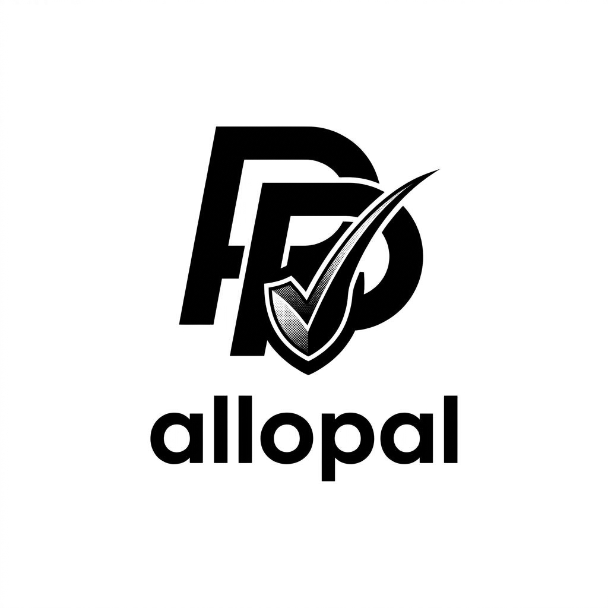

# Allopal

  

> **Deterministic Spending Authorization Layer for PayPal Agentic Commerce**

**Allopal puts a deterministic spending boundary between an AI agent and PayPal.**

A human creates the mandate. The server evaluates every request. PayPal is only reached when the policy passes. The decision ledger records what happened.

> Hackathon submission status: the codebase contains the PayPal sandbox integration, AI agent path, setup documentation, tests, and source assets required by the challenge. The GitHub repository must be made public before submission, and the final Devpost submission still needs the hosted/locally runnable demo, public YouTube video, and tool descriptions.

---

## Contents

- [The problem](#the-problem)
- [What Allopal does](#what-allopal-does)
- [PayPal AI hackathon readiness](#paypal-ai-hackathon-readiness)
- [The core invariant](#the-core-invariant)
- [How it works](#how-it-works)
- [The eight checks](#the-eight-checks)
- [The decision](#the-decision)
- [Guarantees](#guarantees)
- [Canonical demo](#canonical-demo)
- [Runtime verification status](#runtime-verification-status)
- [Product screens](#product-screens)
- [Launch experience](#launch-experience)
- [Architecture](#architecture)
- [Data model](#data-model)
- [API](#api)
- [AI mandate flow](#ai-mandate-flow)
- [Agent action flow](#agent-action-flow)
- [Tech stack](#tech-stack)
- [Running it yourself](#running-it-yourself)
- [Testing](#testing)
- [Claims and evidence](#claims-and-evidence)
- [Project layout](#project-layout)
- [Known limitations](#known-limitations)
- [Documentation rule](#documentation-rule)

---

## PayPal AI hackathon readiness

The project is designed around the challenge's two mandatory technologies: PayPal Developer Platform + AI.

| Requirement | Current state |
|:---|:---|
| Meaningful PayPal technology | Implemented · PayPal Sandbox order creation, payer approval, return/cancel handling, capture, transaction state |
| Meaningful AI | Implemented · Gemini 2.5 Flash structures mandate intent, selects a concrete shopping cart, and explains recorded decisions |
| Working prototype | Implemented · Next.js product with live UI, server APIs, deterministic policy engine, database, and payment lifecycle |
| Documentation | Implemented · setup, architecture, API, scenarios, evidence/claims, tests, and limitations are documented in this repo |
| Public GitHub repository | ACTION REQUIRED · repository visibility is currently private and must be changed to public |
| Open-source license | READY · MIT LICENSE file is present at the repository root |
| Functional demo | READY FOR FINAL DEMO · local setup is documented; a hosted URL is optional because the rules accept complete setup/run instructions |
| Demo video | ACTION REQUIRED · public YouTube video, under 3 minutes |
| Tools disclosure | IMPLEMENTED IN REPO · see the tool table below; repeat the same information in the Devpost submission |
| Official rules | SUBMISSION TASK · final entrant/team eligibility and rule compliance must be completed by the entrant |

### Tools used

| Tool | How Allopal uses it |
|:---|:---|
| PayPal Developer Platform / Sandbox | Creates PayPal checkout orders, receives payer approval, handles return/cancel flows, and captures approved payments |
| Google Gemini 2.5 Flash | Converts natural-language mandates into structured proposals, selects candidate carts for agent shopping tasks, and generates read-only decision explanations |
| Next.js / React / TypeScript | Product UI, server routes, runtime orchestration, and the guarded agent experience |
| Prisma / SQLite | Stores mandates, carts, products, decisions, reservations, and payment transactions |
| Zod | Validates AI output and API payloads before they can cross trusted boundaries |
| Vitest | Covers policy decisions, payment boundaries, concurrency/idempotency, AI safety boundaries, and failure recovery |

### Judge demo path

The clearest end-to-end demonstration is:

1. Open the product and show the human-owned School Shopping mandate.
2. Ask the agent to buy a gaming headset. The agent selects the catalog item, but Allopal denies it and shows PayPal not called.
3. Ask the agent to find school supplies under $20. The agent selects the notebook bundle, the policy passes, and the PayPal execution path becomes available.
4. In PayPal Sandbox, approve the payment and return to Allopal.
5. Show the ledger with the decision and PayPal transaction state.
6. Revoke the mandate and repeat a purchase attempt to show the authorization boundary holding after revocation.

This demonstrates the problem, the AI behavior, the PayPal integration, the policy boundary, and the final audit trail in one short flow.

---

## The problem

Agentic commerce creates a dangerous gap between **what an agent wants to buy** and **what it should actually be allowed to spend**.

Giving an agent direct access to a payment credential makes the agent part of the trust boundary. A prompt, tool call, bug, malicious input, or compromised runtime can then become a money-moving event.

Allopal moves authorization into a deterministic server-side boundary:

- the human owns the mandate;
- the server owns the policy decision;
- the agent supplies a purchase request;
- PayPal is called only after authorization;
- the ledger records the result.

The important part is the order of operations. Authorization is decided before money movement.

## What Allopal does

Allopal treats a PayPal purchase as a controlled execution path rather than letting an agent call a payment provider directly.

1. **Create the mandate.** A human defines amount, merchants, categories, and validity.
2. **Lock the mandate.** The mandate becomes the authoritative spending boundary.
3. **Evaluate the cart.** The server reloads authoritative cart and product data and runs the policy engine.
4. **Reserve budget.** A passing request reserves the required amount before provider execution.
5. **Cross the PayPal boundary.** Mock mode completes deterministically. Real mode creates an order and waits for payer approval before capture.
6. **Record the result.** Decisions, provider transaction state, and budget effects remain inspectable in the ledger.

AI can structure a mandate proposal, choose a candidate cart for a shopping task, and explain a finalized decision. It never becomes the authorization authority.

---

## The core invariant

~~~text
MANDATE PASSES
    → RESERVE BUDGET
    → CREATE PAYPAL ORDER
    → PAYER APPROVAL
    → CAPTURE

MANDATE FAILS
    → NO PAYPAL CALL
    → ZERO MONEY MOVEMENT
~~~

> **AI can propose. Deterministic policy authorizes. PayPal executes.**

That boundary is the product.

---

## How it works

~~~mermaid
flowchart LR
    A["Human defines mandate"] --> B["Mandate is locked"]
    B --> C["Agent selects cart"]
    C --> D["Server reloads authoritative data"]
    D --> E{"8 policy checks"}
    E -- "DENIED" --> X["Decision recorded PayPal not called"]
    E -- "ALLOWED" --> F["Reserve budget"]
    F --> G["Create PayPal order"]
    G --> H{"Payer approval"}
    H -- "cancel / fail" --> I["Release reservation Record failure"]
    H -- "approved" --> J["Capture"]
    J --> K["Record transaction Update budget"]
~~~

The boundary is server-side. The browser does not decide whether a purchase is safe, and the AI layer is deliberately outside the authorization decision.

### Payment sequence

~~~mermaid
sequenceDiagram
    autonumber
    participant A as AI Agent / Client
    participant G as Allopal Gateway
    participant DB as Prisma / SQLite
    participant P as PayPal

    A->>G: POST /api/payments/pay
    G->>DB: Load mandate, cart, products
    G->>G: Run deterministic policy checks

    alt Policy denied
        G->>DB: Persist DENIED decision
        G-->>A: DENIED
        Note over G,P: PayPal is never called
    else Policy allowed
        G->>DB: Reserve mandate budget
        G->>P: Create PayPal order
        P-->>G: Order + approval URL
        G->>DB: Persist pending transaction
        G-->>A: PENDING_APPROVAL
        A->>P: Payer approves or cancels
        P-->>A: Return to Allopal
        A->>G: PayPal return / cancel
        G->>DB: Re-check mandate
        alt Approved
            G->>P: Capture
            P-->>G: Capture result
            G->>DB: Complete transaction + decision
        else Cancelled
            G->>DB: Release reservation + fail transaction
        end
    end
~~~

A real PayPal order is not treated as a completed payment. Payer approval and capture are explicit stages.

---

## The eight checks

The policy engine runs these checks in a deterministic order and short-circuits on failure.

| Check | What it proves | Failure example |
|:---|:---|:---|
| **1. Mandate exists** | The referenced mandate exists in the authoritative database | Mandate not found |
| **2. Not revoked** | The account holder has not explicitly revoked the mandate | Mandate revoked |
| **3. Mandate active** | Status and validity window allow spending now | Expired, premature, or inactive |
| **4. Cart exists** | The cart exists and contains authoritative items | Missing or empty cart |
| **5. Merchant allowed** | Cart and product merchants are permitted | Merchant not allowed |
| **6. Category allowed** | Every product category is permitted | Electronics under a school-only mandate |
| **7. Amount valid** | Amount is positive and reconciles to authoritative item prices | Price mismatch or invalid amount |
| **8. Budget sufficient** | Requested amount fits inside remaining mandate budget | Purchase exceeds remaining budget |

The order matters. A later check must never compensate for a failed trust boundary earlier in the sequence.

---

## The decision

Allopal reduces the policy and payment path to a small set of execution states:

~~~text
DENIED
  → policy failed
  → PayPal not called

ALLOWED
  → policy passed in dry-run
  → PayPal not called

PENDING_APPROVAL
  → order created
  → payer action required

COMPLETED
  → PayPal capture succeeded
  → ledger and mandate budget updated

FAILED
  → execution or provider path failed
  → reservation released when applicable
~~~

Unknown provider state is never presented as a successful payment.

---

## Guarantees

| Guarantee | Implementation boundary | Evidence |
|:---|:---|:---|
| No client-side authorization bypass | Server reloads mandate, cart, products, prices, categories, and merchants | app/api/payments/pay/route.ts |
| No PayPal call on a denied request | Policy decision is made before provider execution | tests/payments/security_boundary.test.ts |
| Revocation is authoritative | Revoked mandates fail before execution | lib/policy/engine.ts |
| Exact money arithmetic | Monetary fields are integer cents | prisma/schema.prisma |
| Concurrent overspending is blocked | Atomic budget reservation and concurrency coverage | tests/payments/concurrency.test.ts |
| Replay side effects are constrained | Idempotency keys and stored transaction state | app/api/payments/pay/route.ts |
| AI cannot authorize money | AI proposal and explanation paths are separate from authorization | tests/ai/proposal.test.ts |
| Real PayPal capture requires payer approval | Create, return, cancel, and capture are separate stages | app/api/payments/paypal/ |
| Failure releases reserved budget | Failure recovery rolls back applicable reservations | tests/failures/failure_recovery.test.ts |

---

## Canonical demo

The seeded demo uses one human-owned mandate:

| Field | Value |
|:---|:---|
| Mandate | **School Shopping** |
| Limit | **$40.00** |
| Allowed category | **School Supplies** |
| Allowed merchants | **Campus Books**, **Paper & Pencil** |

### Scenarios

| Case | Request | Expected policy result | PayPal |
|:---|:---|:---|:---|
| **A** | Notebook Bundle · $18.00 | **ALLOW** | Mock: create + capture · Real: approval → capture |
| **B** | Gaming Headset · $90.00 | **DENY** | Not called |
| **C** | Heavy Notebook Bundle · $25.00 after Case A | **DENY** | Not called |
| **D** | Supplementary Pens · $8.00 after revocation | **DENY** | Not called |
| **E** | Natural-language mandate prompt | **PENDING** until human lock | Not executed |

Case A establishes the passing purchase path. Cases B-D exercise category, budget, and revocation boundaries. Case E shows that AI-generated intent remains inert until human approval.

---

## Runtime verification status

The repository has source-level and automated-test coverage for the authorization boundary, but no independent live PayPal production transaction artifact is currently stored in the repo.

| Area | Current status |
|:---|:---|
| Deterministic policy checks | **TEST-COVERED** |
| Zero-call denial boundary | **TEST-COVERED** |
| Concurrency and replay protection | **TEST-COVERED** |
| AI mandate approval boundary | **TEST-COVERED** |
| Real PayPal approval → capture implementation | **CODE-VERIFIED** |
| Public production PayPal transaction | **NOT LIVE-VERIFIED** |
| External production users | **NOT LIVE-VERIFIED** |

See [docs/CLAIMS.md](docs/CLAIMS.md) for the claim-by-claim ledger and [docs/evidence/README.md](docs/evidence/README.md) for the evidence index.

This distinction is deliberate. A test file proves what a test is designed to cover. A captured runtime artifact proves what actually happened in a specific environment.

---

## Product screens

The product is split into working screens so the landing page stays a map rather than becoming one giant dashboard.

| Screen | Route | Purpose |
|:---|:---|:---|
| Overview | <code>/</code> | Live runtime summary and product map |
| Mandate | <code>/mandate</code> | Human-owned mandate, revocation, and AI draft/lock flow |
| Agent Console | <code>/console</code> | AI agent task runner, canonical cart selection, policy dry-run, and PayPal payment execution |
| Policy | <code>/policy</code> | Full eight-check inspection and execution boundary |
| Ledger | <code>/ledger</code> | Decisions and PayPal transaction history |
| Welcome | <code>/welcome</code> | First-time product introduction |

### Responsive navigation

Desktop exposes the full route set. Smaller screens collapse navigation into a menu.

The demo reset is one action with one implementation. Its presentation changes with the breakpoint:

~~~text
DESKTOP
Draft Mandate → Reset Demo

MOBILE
Draft → Reset icon → Menu
~~~

---

## Launch experience

Allopal starts with an intentional launch sequence:

~~~text
APP LAUNCH
   ↓
SPLASH SCREEN
   ↓
FIRST-RUN WALKTHROUGH MODAL ─────→ PRODUCT
              ↑
         returning users
              │
              └──────────────────→ PRODUCT
~~~

The splash and walkthrough share the product visual language:

- the preserved public/bg.jpg asset is the single backdrop across the app shell and launch surfaces, with no page-level underlay or wash;
- launch surfaces use the same dark-gradient card treatment as the runtime;
- the splash logo card has no ambient blue glow;
- the first-run walkthrough is a modal with three short steps covering the human mandate, deterministic policy gate, and controlled PayPal execution;
- the walkthrough can be skipped or stepped through manually;
- completion is stored locally so returning visitors move directly from splash to the product;
- /welcome remains available as a dedicated introduction route, but it is no longer part of the automatic first-run launch path.

---

## Architecture

~~~mermaid
flowchart TB
    Client["Browser / AI Agent"]

    subgraph Allopal["Allopal · Next.js"]
        UI["Route UI"]
        Runtime["Shared Runtime Hook"]
        Auth["Authorization API"]
        Pay["Payment Gateway"]
        Mandates["Mandate APIs"]
        AI["AI Proposal / Explanation"]
        Policy["Deterministic Policy Engine"]
        Ledger["Decision + PayPal Ledger"]
    end

    DB[("Prisma / SQLite")]
    PayPal["PayPal Sandbox integration"]

    Client --> UI
    UI --> Runtime
    Runtime --> Auth
    Runtime --> Pay
    Auth --> Policy
    Pay --> Policy
    Mandates --> DB
    Policy --> DB
    Pay --> DB
    Pay --> PayPal
    AI --> DB
    Ledger --> DB
~~~

### Architectural boundaries

**Untrusted input.** The client provides identifiers such as mandateId and cartId. Authoritative pricing, categories, merchants, mandate state, and cart contents are loaded server-side.

**AI boundary.** AI can parse natural-language intent into a proposal and explain a recorded decision. AI output is never treated as an authorization result.

**Payment boundary.** The payment route owns policy evaluation, budget reservation, provider execution, and transaction persistence.

**Audit boundary.** Decisions are retained independently from PayPal provider state so a policy-only denial remains visible even though PayPal was never called.

---

## Data model

~~~mermaid
erDiagram
    MANDATE ||--o{ DECISION : governs
    MANDATE ||--o{ PAYMENT_TRANSACTION : reserves
    CART ||--o{ CART_ITEM : contains
    PRODUCT ||--o{ CART_ITEM : referenced_by
    CART ||--o{ DECISION : evaluates
    DECISION ||--o| PAYMENT_TRANSACTION : produces

    MANDATE {
        string id
        string name
        int weeklyLimit
        int spentAmount
        string status
        datetime validFrom
        datetime validUntil
        json allowedCategories
        json allowedMerchants
    }

    PRODUCT {
        string id
        string name
        int price
        string merchant
        string category
    }

    CART {
        string id
        string merchant
        int totalAmount
    }

    DECISION {
        string id
        string status
        int amount
        string reason
        string failedCheck
        string paypalOrderId
    }

    PAYMENT_TRANSACTION {
        string id
        string status
        string orderId
        string captureId
        int amount
    }
~~~

Money is stored as integer cents. The authoritative schema is in [prisma/schema.prisma](prisma/schema.prisma).

---

## API

| Route | Method | Purpose |
|:---|:---:|:---|
| /api/health | GET | Health and database ping |
| /api/state | GET | Shared live runtime state for the UI |
| /api/authorize | POST | Dry-run deterministic policy evaluation |
| /api/payments/pay | POST | Authoritative policy and PayPal payment execution |
| /api/agent/act | POST | AI agent selects a catalog cart, then routes it through dry-run authorization or PayPal execution |
| /api/payments/paypal/return | GET | Re-check mandate and capture an approved PayPal order |
| /api/payments/paypal/cancel | GET | Cancel a pending PayPal flow and release reservation |
| /api/mandates/propose | POST | Convert natural-language intent into a mandate proposal |
| /api/mandates/lock | POST | Explicitly lock a reviewed mandate proposal |
| /api/mandates/revoke | POST | Revoke an active mandate |
| /api/decisions/explain | POST | Generate a read-only explanation for a recorded decision |
| /api/demo/reset | POST | Restore the canonical demo seed state |

### Payment request

~~~json
{
  "mandateId": "mandate-school-shopping",
  "cartId": "cart-case-a"
}
~~~

In real PayPal mode, a passing policy evaluation can return a pending state:

~~~json
{
  "status": "PENDING_APPROVAL",
  "paypalCalled": true,
  "paypalOrderId": "ORDER-123",
  "approvalUrl": "https://www.sandbox.paypal.com/checkoutnow?token=ORDER-123",
  "paypalCaptureId": null
}
~~~

A denied request returns the policy failure without calling PayPal:

~~~json
{
  "status": "DENIED",
  "paypalCalled": false,
  "reason": "Category 'Electronics' is not allowed by this mandate"
}
~~~

---

## AI mandate flow

The AI surface is intentionally narrow.

~~~mermaid
flowchart LR
    Prompt["Natural-language intent"] --> Propose["/api/mandates/propose"]
    Propose --> Review["Human reviews proposal"]
    Review --> Lock["/api/mandates/lock"]
    Lock --> Active["ACTIVE mandate"]
    Active --> Policy["Deterministic policy engine"]
~~~

The proposal route structures intent. The lock route records explicit human approval. Payment authorization does not consume arbitrary AI output as an allow decision.

---

## Agent action flow

The console includes a real guarded agent path rather than using AI only for mandate drafting.

~~~text
Natural-language shopping task
            ↓
     AI agent selects
  one server-side cart
            ↓
   deterministic policy
      engine decides
       ↙           ↘
   DENIED         ALLOWED
     ↓                ↓
PayPal not called   PayPal execution
                     ↓
               payer approval
                     ↓
                 capture
~~~

The agent receives a server-authoritative catalog and can select a cart that is later denied by policy. Its selection is treated as untrusted input. The payment route reloads the mandate and cart from the database, evaluates the deterministic checks, reserves budget, and only then reaches PayPal.

This creates the intended separation:

- **AI agent:** understands the shopping request and proposes a concrete action.
- **Allopal policy engine:** owns the authorization decision.
- **PayPal:** owns the payment execution lifecycle.

The /api/agent/act endpoint supports DRY_RUN and EXECUTE modes so the same agent path can be demonstrated without or with payment execution.

## Tech stack

| Layer | Technology |
|:---|:---|
| Frontend | Next.js 14, React 18, Tailwind CSS |
| Language | TypeScript 5.6 |
| Data | Prisma 5 + SQLite |
| Validation | Zod |
| Icons | Lucide React |
| Payments | PayPal Sandbox integration |
| Testing | Vitest |
| Tooling | npm, TypeScript, ESLint, Prisma |

---

## Running it yourself

### Requirements

- Node.js 18 or 20
- npm

### Install

~~~bash
git clone https://github.com/Tajudeeen/allopal.git
cd allopal
npm install
~~~

### Environment

~~~bash
cp .env.example .env
~~~

Example:

~~~env
DATABASE_URL="file:./prisma/dev.db"
NODE_ENV="development"
PORT=3000
PAYPAL_CLIENT_ID="mock_client_id"
PAYPAL_CLIENT_SECRET="mock_client_secret"
PAYPAL_API_BASE_URL="https://api-m.sandbox.paypal.com"
~~~

### Database

~~~bash
npm run prisma:generate
npm run prisma:migrate
npm run prisma:seed
~~~

### Start

~~~bash
npm run dev
~~~

Then open http://localhost:3000.

Use **Reset Demo** from the navigation to restore the canonical seed state after running payment scenarios.

---

## Testing

### Commands

~~~bash
npm test
npm run typecheck
npm run lint
npm run build
~~~

### Test map

| Area | Tests |
|:---|:---|
| Foundation | tests/foundation.test.ts |
| Database / seed | tests/database_seed.test.ts |
| Policy | tests/policy/engine.test.ts |
| Authorization API | tests/api/authorize.test.ts |
| PayPal | tests/payments/paypal.test.ts |
| Security boundary | tests/payments/security_boundary.test.ts |
| Concurrency / idempotency | tests/payments/concurrency.test.ts |
| AI proposal | tests/ai/proposal.test.ts |
| AI explanation | tests/ai/explainer.test.ts |
| E2E | tests/e2e/allopal_full_flow.test.ts |
| Security audit | tests/security/security_audit.test.ts |
| Failure recovery | tests/failures/failure_recovery.test.ts |
| Theme contrast | tests/theme/contrast.test.ts |

The test inventory documents the verification surface. A current green test result should be captured from the environment where the tests were run rather than inferred from the presence of the files. Light-surface neutral text uses deeper slate/grey tokens for easier scanning, while muted text inside dark-gradient cards remains intentionally brighter.

---

## Claims and evidence

Allopal follows an evidence-first documentation model inspired by strong infrastructure and protocol repositories.

- [docs/CLAIMS.md](docs/CLAIMS.md) is the public claims ledger.
- [docs/evidence/README.md](docs/evidence/README.md) indexes reproducible evidence artifacts.
- [SECURITY.md](SECURITY.md) describes the security posture and reporting expectations.

The rule is simple: **do not turn an implementation detail into a proof claim without evidence.**

---

## Project layout

~~~text
allopal/
├── app/
│   ├── api/                  # authorization, mandates, payments, state
│   ├── console/              # agent commerce screen
│   ├── ledger/               # audit screen
│   ├── mandate/              # mandate control screen
│   ├── policy/               # policy inspection screen
│   ├── welcome/              # first-time intro
│   └── page.tsx              # overview
├── components/
│   ├── gate/                 # visual policy gate
│   ├── ledger/               # decision ledger
│   ├── mandate/              # mandate UI + AI modal
│   └── payment/              # agent commerce console
├── hooks/
│   └── useAllopalRuntime.ts  # shared live state + actions
├── lib/
│   ├── policy/               # deterministic policy engine
│   └── theme/                # contrast utilities
├── prisma/
│   ├── schema.prisma
│   └── seed.ts
├── tests/
│   ├── ai/
│   ├── api/
│   ├── e2e/
│   ├── failures/
│   ├── payments/
│   ├── policy/
│   ├── security/
│   └── theme/
├── docs/
│   ├── CLAIMS.md
│   └── evidence/
└── SECURITY.md
~~~

---

## Known limitations

The current build is a hackathon/demo implementation rather than a production payment platform.

1. **No multi-user authentication/session binding.** Mandates and demo reset are not associated with authenticated accounts yet.
2. **PayPal production evidence is not captured.** Real-mode code supports the approval/capture lifecycle, but the repository does not currently publish an independent production transaction artifact.
3. **No background reconciliation worker.** A pending PayPal transaction relies on the explicit return/cancel lifecycle rather than a dedicated reconciliation service.
4. **Demo reset is intentionally powerful.** It is useful for deterministic demos but must be protected behind account-level authorization before production.
5. **Local persistence is SQLite.** A production deployment would require a durable, properly secured database and operational monitoring.

---

## Documentation rule

Documentation ships with the feature.

When a new capability changes behavior, update the relevant documentation in the same change set:

1. Update the README behavior and architecture sections.
2. Update the canonical scenario table when outcomes change.
3. Update API examples when request or response contracts change.
4. Add or update the claim in docs/CLAIMS.md.
5. Add reproducible runtime evidence under docs/evidence/ when a claim becomes externally verifiable.
6. Keep limitations explicit rather than hiding them.

Documentation is part of the implementation, not a final cleanup step.
